<div align="center">

<br/><br/>
 
<a href="https://github.com/matteo0003"></a>&nbsp;
&nbsp;

 
<br/><br/>
 
### Je conçois des applications web, des logiciels et des bots Discord.
 
**Des interfaces soignées. Des systèmes fiables. Du code propre.**
 
<br/>
[**À propos**](#01--à-propos) &nbsp;·&nbsp; [**Stack**](#02--stack-technique) &nbsp;·&nbsp; [**Réalisations**](#03--réalisations) &nbsp;·&nbsp; [**Principes**](#04--principes) &nbsp;·&nbsp; [**Contact**](#05--contact)
 
</div>
<br/>
---
 
## 01 / À propos
 
Je suis développeur full-stack, autodidacte depuis 2020 : sites web, serveurs de RP FiveM, bots Discord et applications sur mesure. Diplômé d’une licence d’informatique à l’UBO (Brest), je cherche un poste ou une alternance en développement.
 
J’aime travailler sur toute la chaîne : **interfaces, logique serveur, bases de données, infrastructure et déploiement**. Je fais attention à la simplicité, à la maintenabilité et aux détails qui rendent un logiciel agréable à utiliser.
 
```ts
const matteo = {
  role: "Développeur full-stack",
  domaines: ["Web", "Applications desktop", "Bots Discord", "DevOps"],
  langages: ["TypeScript", "JavaScript", "PHP", "Python", "C", "Rust", "Lua"],
  frontend: ["React", "Next.js", "Vue", "Nuxt", "Tailwind CSS"],
  backend: ["Node.js", "Bun", "API REST"],
  desktop: ["Tauri"],
  donnees: ["PostgreSQL", "MySQL", "MariaDB", "SQLite"],
  infrastructure: ["Docker", "Dokploy", "NGINX", "Cloudflare", "Tailscale"],
  langues: ["Français", "Anglais (courant)", "Espagnol (intermédiaire)"],
  philosophie: "Construire avec un but. Rester simple.",
} as const;
```
 
<br/>
---
 
## 02 / Stack technique
 
Un aperçu des langages, frameworks, outils et environnements que j’utilise ou avec lesquels j’ai travaillé.
 
<table>
  <tr>
    <td width="50%" valign="top">
      <h4>Langages</h4>
      <picture>
        <source media="(prefers-color-scheme: dark)" srcset="https://skillicons.dev/icons?i=html&amp;theme=dark">
        <source media="(prefers-color-scheme: light)" srcset="https://skillicons.dev/icons?i=html&amp;theme=light">
        
      </picture>
      &nbsp;
      <picture>
        <source media="(prefers-color-scheme: dark)" srcset="https://skillicons.dev/icons?i=css&amp;theme=dark">
        <source media="(prefers-color-scheme: light)" srcset="https://skillicons.dev/icons?i=css&amp;theme=light">
        
      </picture>
      &nbsp;
      <picture>
        <source media="(prefers-color-scheme: dark)" srcset="https://skillicons.dev/icons?i=js&amp;theme=dark">
        <source media="(prefers-color-scheme: light)" srcset="https://skillicons.dev/icons?i=js&amp;theme=light">
        
      </picture>
      &nbsp;
      <picture>
        <source media="(prefers-color-scheme: dark)" srcset="https://skillicons.dev/icons?i=ts&amp;theme=dark">
        <source media="(prefers-color-scheme: light)" srcset="https://skillicons.dev/icons?i=ts&amp;theme=light">
        
      </picture>
      &nbsp;
      <picture>
        <source media="(prefers-color-scheme: dark)" srcset="https://skillicons.dev/icons?i=php&amp;theme=dark">
        <source media="(prefers-color-scheme: light)" srcset="https://skillicons.dev/icons?i=php&amp;theme=light">
        
      </picture>
      &nbsp;
      <picture>
        <source media="(prefers-color-scheme: dark)" srcset="https://skillicons.dev/icons?i=py&amp;theme=dark">
        <source media="(prefers-color-scheme: light)" srcset="https://skillicons.dev/icons?i=py&amp;theme=light">
        
      </picture>
      &nbsp;
      <picture>
        <source media="(prefers-color-scheme: dark)" srcset="https://skillicons.dev/icons?i=c&amp;theme=dark">
        <source media="(prefers-color-scheme: light)" srcset="https://skillicons.dev/icons?i=c&amp;theme=light">
        
      </picture>
      &nbsp;
      <picture>
        <source media="(prefers-color-scheme: dark)" srcset="https://skillicons.dev/icons?i=rust&amp;theme=dark">
        <source media="(prefers-color-scheme: light)" srcset="https://skillicons.dev/icons?i=rust&amp;theme=light">
        
      </picture>
      &nbsp;
      <picture>
        <source media="(prefers-color-scheme: dark)" srcset="https://skillicons.dev/icons?i=lua&amp;theme=dark">
        <source media="(prefers-color-scheme: light)" srcset="https://skillicons.dev/icons?i=lua&amp;theme=light">
        
      </picture>
      <br/><br/>
      <sub><code>HTML</code> · <code>CSS</code> · <code>JavaScript</code> · <code>TypeScript</code> · <code>PHP</code> · <code>Python</code> · <code>C</code> · <code>Rust</code> · <code>Lua</code></sub>
      <br/><br/>
      <sub>Développement web · Scripts · Programmation système</sub>
    </td>
    <td width="50%" valign="top">
      <h4>Front-end &amp; UI</h4>
      <picture>
        <source media="(prefers-color-scheme: dark)" srcset="https://skillicons.dev/icons?i=react&amp;theme=dark">
        <source media="(prefers-color-scheme: light)" srcset="https://skillicons.dev/icons?i=react&amp;theme=light">
        
      </picture>
      &nbsp;
      <picture>
        <source media="(prefers-color-scheme: dark)" srcset="https://skillicons.dev/icons?i=nextjs&amp;theme=dark">
        <source media="(prefers-color-scheme: light)" srcset="https://skillicons.dev/icons?i=nextjs&amp;theme=light">
        
      </picture>
      &nbsp;
      <picture>
        <source media="(prefers-color-scheme: dark)" srcset="https://skillicons.dev/icons?i=vue&amp;theme=dark">
        <source media="(prefers-color-scheme: light)" srcset="https://skillicons.dev/icons?i=vue&amp;theme=light">
        
      </picture>
      &nbsp;
      <picture>
        <source media="(prefers-color-scheme: dark)" srcset="https://skillicons.dev/icons?i=nuxtjs&amp;theme=dark">
        <source media="(prefers-color-scheme: light)" srcset="https://skillicons.dev/icons?i=nuxtjs&amp;theme=light">
        
      </picture>
      &nbsp;
      <picture>
        <source media="(prefers-color-scheme: dark)" srcset="https://skillicons.dev/icons?i=tailwind&amp;theme=dark">
        <source media="(prefers-color-scheme: light)" srcset="https://skillicons.dev/icons?i=tailwind&amp;theme=light">
        
      </picture>
      &nbsp;
      <picture>
        <source media="(prefers-color-scheme: dark)" srcset="https://skillicons.dev/icons?i=vite&amp;theme=dark">
        <source media="(prefers-color-scheme: light)" srcset="https://skillicons.dev/icons?i=vite&amp;theme=light">
        
      </picture>
      &nbsp;
      <picture>
        <source media="(prefers-color-scheme: dark)" srcset="https://skillicons.dev/icons?i=figma&amp;theme=dark">
        <source media="(prefers-color-scheme: light)" srcset="https://skillicons.dev/icons?i=figma&amp;theme=light">
        
      </picture>
      <br/><br/>
      <sub><code>React</code> · <code>Next.js</code> · <code>Vue.js</code> · <code>Nuxt</code> · <code>Tailwind CSS</code> · <code>shadcn/ui</code> · <code>Nuxt UI</code> · <code>Vue Flow</code> · <code>Vite</code> · <code>Figma</code></sub>
      <br/><br/>
      <sub>Interfaces responsives · Design systems · Composants · UX</sub>
    </td>
  </tr>
  <tr>
    <td width="50%" valign="top">
      <h4>Back-end &amp; API</h4>
      <picture>
        <source media="(prefers-color-scheme: dark)" srcset="https://skillicons.dev/icons?i=nodejs&amp;theme=dark">
        <source media="(prefers-color-scheme: light)" srcset="https://skillicons.dev/icons?i=nodejs&amp;theme=light">
        
      </picture>
      &nbsp;
      <picture>
        <source media="(prefers-color-scheme: dark)" srcset="https://skillicons.dev/icons?i=bun&amp;theme=dark">
        <source media="(prefers-color-scheme: light)" srcset="https://skillicons.dev/icons?i=bun&amp;theme=light">
        
      </picture>
      &nbsp;
      <picture>
        <source media="(prefers-color-scheme: dark)" srcset="https://skillicons.dev/icons?i=php&amp;theme=dark">
        <source media="(prefers-color-scheme: light)" srcset="https://skillicons.dev/icons?i=php&amp;theme=light">
        
      </picture>
      &nbsp;
      <picture>
        <source media="(prefers-color-scheme: dark)" srcset="https://skillicons.dev/icons?i=symfony&amp;theme=dark">
        <source media="(prefers-color-scheme: light)" srcset="https://skillicons.dev/icons?i=symfony&amp;theme=light">
        
      </picture>
      &nbsp;
      <picture>
        <source media="(prefers-color-scheme: dark)" srcset="https://skillicons.dev/icons?i=py&amp;theme=dark">
        <source media="(prefers-color-scheme: light)" srcset="https://skillicons.dev/icons?i=py&amp;theme=light">
        
      </picture>
      <br/><br/>
      <sub><code>Node.js</code> · <code>Bun</code> · <code>AdonisJS</code> · <code>Nitro</code> · <code>Hono</code> · <code>Symfony</code> · <code>CodeIgniter</code></sub>
      <br/><br/>
      <sub>API REST · Authentification · Architecture serveur · Intégrations</sub>
    </td>
    <td width="50%" valign="top">
      <h4>Bots Discord</h4>
      <picture>
        <source media="(prefers-color-scheme: dark)" srcset="https://skillicons.dev/icons?i=discord&amp;theme=dark">
        <source media="(prefers-color-scheme: light)" srcset="https://skillicons.dev/icons?i=discord&amp;theme=light">
        
      </picture>
      &nbsp;
      <picture>
        <source media="(prefers-color-scheme: dark)" srcset="https://skillicons.dev/icons?i=discordjs&amp;theme=dark">
        <source media="(prefers-color-scheme: light)" srcset="https://skillicons.dev/icons?i=discordjs&amp;theme=light">
        
      </picture>
      &nbsp;
      <picture>
        <source media="(prefers-color-scheme: dark)" srcset="https://skillicons.dev/icons?i=ts&amp;theme=dark">
        <source media="(prefers-color-scheme: light)" srcset="https://skillicons.dev/icons?i=ts&amp;theme=light">
        
      </picture>
      &nbsp;
      <picture>
        <source media="(prefers-color-scheme: dark)" srcset="https://skillicons.dev/icons?i=nodejs&amp;theme=dark">
        <source media="(prefers-color-scheme: light)" srcset="https://skillicons.dev/icons?i=nodejs&amp;theme=light">
        
      </picture>
      &nbsp;
      <picture>
        <source media="(prefers-color-scheme: dark)" srcset="https://skillicons.dev/icons?i=bun&amp;theme=dark">
        <source media="(prefers-color-scheme: light)" srcset="https://skillicons.dev/icons?i=bun&amp;theme=light">
        
      </picture>
      <br/><br/>
      <sub><code>Discord.js</code> · <code>Sapphire Framework</code> · <code>TypeScript</code> · <code>Node.js</code> · <code>Bun</code></sub>
      <br/><br/>
      <sub>Slash commands · Modération · Automatisations · Intégrations</sub>
    </td>
  </tr>
  <tr>
    <td width="50%" valign="top">
      <h4>Bases de données &amp; ORM</h4>
      <picture>
        <source media="(prefers-color-scheme: dark)" srcset="https://skillicons.dev/icons?i=postgres&amp;theme=dark">
        <source media="(prefers-color-scheme: light)" srcset="https://skillicons.dev/icons?i=postgres&amp;theme=light">
        
      </picture>
      &nbsp;
      <picture>
        <source media="(prefers-color-scheme: dark)" srcset="https://skillicons.dev/icons?i=mysql&amp;theme=dark">
        <source media="(prefers-color-scheme: light)" srcset="https://skillicons.dev/icons?i=mysql&amp;theme=light">
        
      </picture>
      &nbsp;
      <picture>
        <source media="(prefers-color-scheme: dark)" srcset="https://skillicons.dev/icons?i=sqlite&amp;theme=dark">
        <source media="(prefers-color-scheme: light)" srcset="https://skillicons.dev/icons?i=sqlite&amp;theme=light">
        
      </picture>
      &nbsp;
      <picture>
        <source media="(prefers-color-scheme: dark)" srcset="https://skillicons.dev/icons?i=supabase&amp;theme=dark">
        <source media="(prefers-color-scheme: light)" srcset="https://skillicons.dev/icons?i=supabase&amp;theme=light">
        
      </picture>
      &nbsp;
      <picture>
        <source media="(prefers-color-scheme: dark)" srcset="https://skillicons.dev/icons?i=prisma&amp;theme=dark">
        <source media="(prefers-color-scheme: light)" srcset="https://skillicons.dev/icons?i=prisma&amp;theme=light">
        
      </picture>
      <br/><br/>
      <sub><code>PostgreSQL</code> · <code>MySQL</code> · <code>MariaDB</code> · <code>SQLite</code> · <code>Supabase</code> · <code>Prisma ORM</code> · <code>Drizzle ORM</code></sub>
      <br/><br/>
      <sub>SQL · Modélisation · Migrations · Transactions · Synchronisation</sub>
    </td>
    <td width="50%" valign="top">
      <h4>Infrastructure &amp; DevOps</h4>
      <picture>
        <source media="(prefers-color-scheme: dark)" srcset="https://skillicons.dev/icons?i=docker&amp;theme=dark">
        <source media="(prefers-color-scheme: light)" srcset="https://skillicons.dev/icons?i=docker&amp;theme=light">
        
      </picture>
      &nbsp;
      <picture>
        <source media="(prefers-color-scheme: dark)" srcset="https://skillicons.dev/icons?i=nginx&amp;theme=dark">
        <source media="(prefers-color-scheme: light)" srcset="https://skillicons.dev/icons?i=nginx&amp;theme=light">
        
      </picture>
      &nbsp;
      <picture>
        <source media="(prefers-color-scheme: dark)" srcset="https://skillicons.dev/icons?i=cloudflare&amp;theme=dark">
        <source media="(prefers-color-scheme: light)" srcset="https://skillicons.dev/icons?i=cloudflare&amp;theme=light">
        
      </picture>
      &nbsp;
      <picture>
        <source media="(prefers-color-scheme: dark)" srcset="https://skillicons.dev/icons?i=ubuntu&amp;theme=dark">
        <source media="(prefers-color-scheme: light)" srcset="https://skillicons.dev/icons?i=ubuntu&amp;theme=light">
        
      </picture>
      &nbsp;
      <picture>
        <source media="(prefers-color-scheme: dark)" srcset="https://skillicons.dev/icons?i=linux&amp;theme=dark">
        <source media="(prefers-color-scheme: light)" srcset="https://skillicons.dev/icons?i=linux&amp;theme=light">
        
      </picture>
      &nbsp;
      <picture>
        <source media="(prefers-color-scheme: dark)" srcset="https://skillicons.dev/icons?i=bash&amp;theme=dark">
        <source media="(prefers-color-scheme: light)" srcset="https://skillicons.dev/icons?i=bash&amp;theme=light">
        
      </picture>
      <br/><br/>
      <sub><code>Docker</code> · <code>Docker Compose</code> · <code>Dokploy</code> · <code>NGINX</code> · <code>Cloudflare</code> · <code>Tailscale</code> · <code>PM2</code> · <code>SSH</code></sub>
      <br/><br/>
      <sub>VPS · Reverse proxy · Cloudflare Tunnel · Déploiement · Réseau</sub>
    </td>
  </tr>
  <tr>
    <td width="50%" valign="top">
      <h4>Monitoring &amp; analytics</h4>
      &nbsp;
      <br/><br/>
      <sub><code>Umami</code> · <code>Uptime Kuma</code></sub>
      <br/><br/>
      <sub>Statistiques web · Surveillance de disponibilité · Auto-hébergement</sub>
    </td>
    <td width="50%" valign="top">
      <h4>Systèmes d’exploitation</h4>
      <picture>
        <source media="(prefers-color-scheme: dark)" srcset="https://skillicons.dev/icons?i=windows&amp;theme=dark">
        <source media="(prefers-color-scheme: light)" srcset="https://skillicons.dev/icons?i=windows&amp;theme=light">
        
      </picture>
      &nbsp;
      <picture>
        <source media="(prefers-color-scheme: dark)" srcset="https://skillicons.dev/icons?i=apple&amp;theme=dark">
        <source media="(prefers-color-scheme: light)" srcset="https://skillicons.dev/icons?i=apple&amp;theme=light">
        
      </picture>
      &nbsp;
      <picture>
        <source media="(prefers-color-scheme: dark)" srcset="https://skillicons.dev/icons?i=linux&amp;theme=dark">
        <source media="(prefers-color-scheme: light)" srcset="https://skillicons.dev/icons?i=linux&amp;theme=light">
        
      </picture>
      &nbsp;
      <picture>
        <source media="(prefers-color-scheme: dark)" srcset="https://skillicons.dev/icons?i=ubuntu&amp;theme=dark">
        <source media="(prefers-color-scheme: light)" srcset="https://skillicons.dev/icons?i=ubuntu&amp;theme=light">
        
      </picture>
      <br/><br/>
      <sub><code>Windows</code> · <code>macOS</code> · <code>Linux</code> · <code>Ubuntu</code></sub>
      <br/><br/>
      <sub>Administration · Terminal · Scripts shell · Environnements de développement</sub>
    </td>
  </tr>
  <tr>
    <td width="50%" valign="top">
      <h4>Outils &amp; qualité</h4>
      <picture>
        <source media="(prefers-color-scheme: dark)" srcset="https://skillicons.dev/icons?i=git&amp;theme=dark">
        <source media="(prefers-color-scheme: light)" srcset="https://skillicons.dev/icons?i=git&amp;theme=light">
        
      </picture>
      &nbsp;
      <picture>
        <source media="(prefers-color-scheme: dark)" srcset="https://skillicons.dev/icons?i=github&amp;theme=dark">
        <source media="(prefers-color-scheme: light)" srcset="https://skillicons.dev/icons?i=github&amp;theme=light">
        
      </picture>
      &nbsp;
      <picture>
        <source media="(prefers-color-scheme: dark)" srcset="https://skillicons.dev/icons?i=githubactions&amp;theme=dark">
        <source media="(prefers-color-scheme: light)" srcset="https://skillicons.dev/icons?i=githubactions&amp;theme=light">
        
      </picture>
      &nbsp;
      <picture>
        <source media="(prefers-color-scheme: dark)" srcset="https://skillicons.dev/icons?i=vscode&amp;theme=dark">
        <source media="(prefers-color-scheme: light)" srcset="https://skillicons.dev/icons?i=vscode&amp;theme=light">
        
      </picture>
      &nbsp;
      <picture>
        <source media="(prefers-color-scheme: dark)" srcset="https://skillicons.dev/icons?i=npm&amp;theme=dark">
        <source media="(prefers-color-scheme: light)" srcset="https://skillicons.dev/icons?i=npm&amp;theme=light">
        
      </picture>
      &nbsp;
      <picture>
        <source media="(prefers-color-scheme: dark)" srcset="https://skillicons.dev/icons?i=pnpm&amp;theme=dark">
        <source media="(prefers-color-scheme: light)" srcset="https://skillicons.dev/icons?i=pnpm&amp;theme=light">
        
      </picture>
      &nbsp;
      <picture>
        <source media="(prefers-color-scheme: dark)" srcset="https://skillicons.dev/icons?i=postman&amp;theme=dark">
        <source media="(prefers-color-scheme: light)" srcset="https://skillicons.dev/icons?i=postman&amp;theme=light">
        
      </picture>
      <br/><br/>
      <sub><code>Git</code> · <code>GitHub</code> · <code>GitHub Actions</code> · <code>VS Code</code> · <code>npm</code> · <code>pnpm</code> · <code>Prettier</code> · <code>ESLint</code> · <code>Playwright</code> · <code>Postman</code> · <code>Jira</code></sub>
      <br/><br/>
      <sub>Versioning · CI/CD · Linting · Formatage · Tests · Suivi de tickets</sub>
    </td>
    <td width="50%" valign="top">
      <h4>Desktop &amp; embarqué</h4>
      <picture>
        <source media="(prefers-color-scheme: dark)" srcset="https://skillicons.dev/icons?i=tauri&amp;theme=dark">
        <source media="(prefers-color-scheme: light)" srcset="https://skillicons.dev/icons?i=tauri&amp;theme=light">
        
      </picture>
      &nbsp;
      <picture>
        <source media="(prefers-color-scheme: dark)" srcset="https://skillicons.dev/icons?i=rust&amp;theme=dark">
        <source media="(prefers-color-scheme: light)" srcset="https://skillicons.dev/icons?i=rust&amp;theme=light">
        
      </picture>
      &nbsp;
      <picture>
        <source media="(prefers-color-scheme: dark)" srcset="https://skillicons.dev/icons?i=c&amp;theme=dark">
        <source media="(prefers-color-scheme: light)" srcset="https://skillicons.dev/icons?i=c&amp;theme=light">
        
      </picture>
      &nbsp;
      <picture>
        <source media="(prefers-color-scheme: dark)" srcset="https://skillicons.dev/icons?i=arduino&amp;theme=dark">
        <source media="(prefers-color-scheme: light)" srcset="https://skillicons.dev/icons?i=arduino&amp;theme=light">
        
      </picture>
      &nbsp;
      <picture>
        <source media="(prefers-color-scheme: dark)" srcset="https://skillicons.dev/icons?i=raspberrypi&amp;theme=dark">
        <source media="(prefers-color-scheme: light)" srcset="https://skillicons.dev/icons?i=raspberrypi&amp;theme=light">
        
      </picture>
      <br/><br/>
      <sub><code>Tauri 2</code> · <code>Rust</code> · <code>C</code> · <code>Arduino</code> · <code>Raspberry Pi</code></sub>
      <br/><br/>
      <sub>Applications desktop · Communication réseau · Systèmes embarqués</sub>
    </td>
  </tr>
</table>
<br/>
---
 
## 03 / Réalisations
 
Quelques projets, expérimentations et idées concrétisées.
 
<table>
  <tr>
    <td width="50%" valign="top">
      
      <h4>Icare</h4>
      <p>Projet B2B entre deux entreprises : application web, bots Discord, intégration d’API et paiement en ligne.</p>
      <sub><code>TypeScript</code> · <code>Nuxt</code> · <code>PostgreSQL</code> · <code>Discord.js</code></sub>
      <br/><br/>
      <a href="https://icare-bot.fr"><b>Voir le site ↗</b></a>
    </td>
    <td width="50%" valign="top">
      
      <h4>Système de RoIP sur mesure</h4>
      <p>Conception et réalisation d’un système de radio sur IP pour les besoins de communication de l’équipe d’OBI 1 pendant l’OBILan (stage, 2026).</p>
      <sub><code>RoIP</code> · <code>Réseau</code> · <code>Python</code> · <code>Raspberry Pi</code></sub>
      <br/><br/>
      <sub>Projet réalisé en stage · 2026</sub>
    </td>
  </tr>
</table>
<div align="center">
<a href="https://github.com/matteo0003?tab=repositories"><b>Voir tous les dépôts →</b></a>
 
</div>
<br/>
---
 
## 04 / Principes
 
<table>
  <tr>
    <td width="33%" valign="top">
      <sub><b>01</b></sub>
      <h4>Simplicité</h4>
      Privilégier les solutions claires plutôt que la complexité inutile.
    </td>
    <td width="33%" valign="top">
      <sub><b>02</b></sub>
      <h4>Rigueur</h4>
      Soigner les détails qui font la qualité d’un logiciel.
    </td>
    <td width="33%" valign="top">
      <sub><b>03</b></sub>
      <h4>Curiosité</h4>
      Continuer à apprendre, expérimenter et progresser.
    </td>
  </tr>
</table>
<br/>
---
 
## 05 / Contact
 
Une idée, un projet ou une opportunité ? N’hésitez pas à me contacter.
 
<div align="center">
<a href="https://github.com/matteo0003"></a>&nbsp;
<a href="https://www.linkedin.com/in/TON-PROFIL"></a>&nbsp;
<a href="mailto:ton@email.fr"></a>
 
<br/><br/>
 
<sub>Conçu avec soin. Construit avec curiosité.</sub>
<br/>
<sub>© 2026 Mattéo · <a href="https://github.com/matteo0003">matteo0003</a></sub>
 
</div>
 
